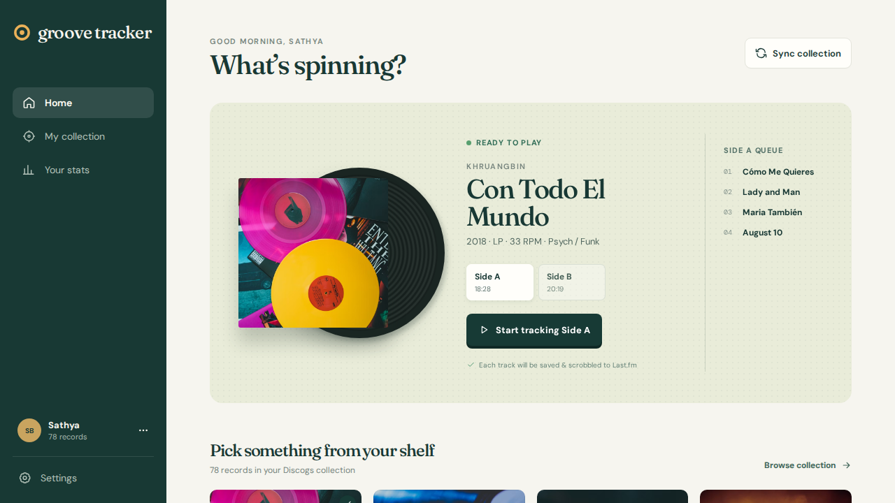

# Groove Tracker

A responsive, installable web app for recording vinyl listening sessions.



The current front-end prototype includes:

- a Discogs-connected collection experience, with album, artist, and genre search
- side-by-side listening tracking and per-side track queues
- a now-playing presentation designed for desktop, tablet, and phone
- locally persisted play history and lightweight listening analytics
- configurable daily, weekly, or monthly collection refresh preferences
- Last.fm scrobble status in the listening flow

## Run locally

```sh
npm install
npm run dev
```

## Run the API locally

1. Create a PostgreSQL database named `groove_tracker`.
2. Copy `.env.example` to `.env`, then provide the database URL, Discogs application credentials, and a 32-byte encryption key.
3. Create a Discogs application and set its callback URL to:

   ```text
   http://localhost:3001/api/integrations/discogs/callback
   ```

4. Run the migration and both processes:

   ```sh
   npm run db:migrate
   npm run api
   npm run dev
   ```

Open Settings in the PWA and choose **Connect Discogs**. The collection sync control calls the API once the account is connected.

## Run with Docker Compose

The Compose stack starts PostgreSQL, the API, the Vite PWA, and an hourly sync worker.

```sh
cp .env.example .env
# Set DISCOGS_CONSUMER_KEY, DISCOGS_CONSUMER_SECRET, and TOKEN_ENCRYPTION_KEY in .env
docker compose up --build
```

The PWA is available at `localhost:5173`, the API at `localhost:3001`, and PostgreSQL at `localhost:5432`. PostgreSQL data is retained in the `postgres-data` Docker volume. To reset only local database data:

```sh
docker compose down -v
```

## API capabilities

| Capability | Endpoint |
| --- | --- |
| Begin Discogs OAuth | `GET /api/integrations/discogs/start` |
| Check Discogs connection | `GET /api/integrations/discogs` |
| Sync / list collection | `POST /api/collection/sync`, `GET /api/collection` |
| Load a release’s sides and tracks | `GET /api/collection/:id` |
| Set background refresh cadence | `PATCH /api/settings/sync-frequency` |
| Begin / stop a side play | `POST /api/listens`, `PATCH /api/listens/:id` |

Discogs tokens are encrypted before storage. The collection sync stores release summaries first, then fetches and caches a release’s tracklist when that record is selected. Starting a side creates a listening session and one pending scrobble job per track.

## Scheduled collection refresh

Run `npm run worker:sync` from your host’s scheduler every hour. It only syncs users whose selected daily, weekly, or monthly cadence is due. The worker leaves Last.fm jobs in the database for the forthcoming Last.fm worker.
